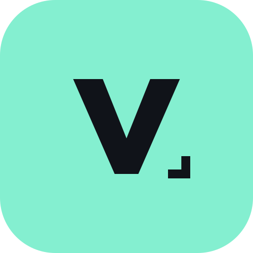
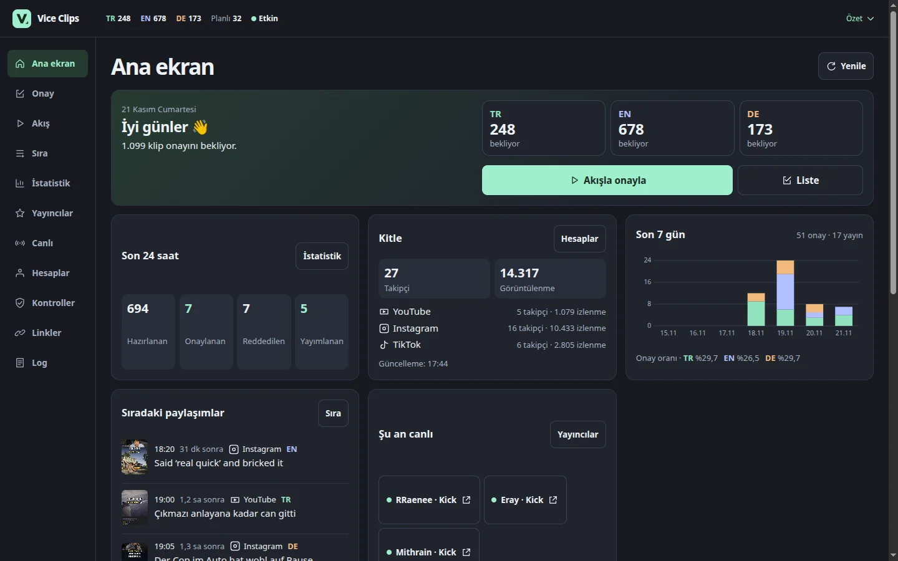
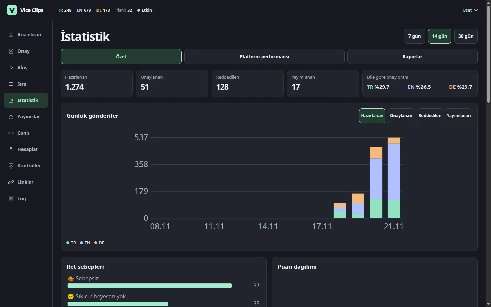
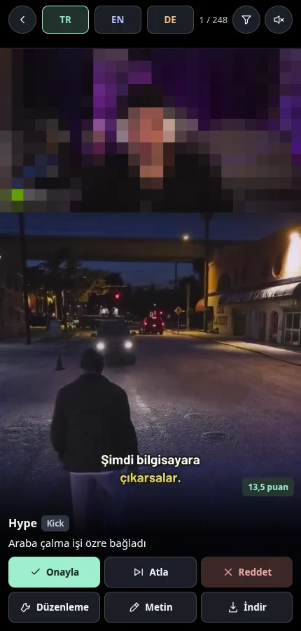

# Vice Clips

**Stream highlights, clipped while you sleep.**

Vice Clips watches long gaming live streams, finds the moments chat goes wild about, and turns them into captioned vertical clips for YouTube Shorts, TikTok and Instagram Reels, in English, German and Turkish.

[**Website**](https://onullusoy.github.io/viceclips/) · [How it works](#how-it-works) · [The panel](#the-panel) · [Channels](#see-it-live) · [Beta](#paid-beta-coming-soon)

 

> [!NOTE]
> **Vice Clips is in active development.** A paid beta is coming soon.
> ⭐ **Star this repository** and pick **Watch → Custom → Releases** to hear about it first.

## How it works

| | Step | What happens |
|---|---|---|
| 1 | **Watch** | Follows the streamers you choose on Twitch, Kick and YouTube and picks up their finished streams. |
| 2 | **Score** | Reads chat activity, audio peaks and the transcript to rank every moment. Only the strongest few per hour make it through. |
| 3 | **Render** | Cuts a 9:16 clip with facecam on top, burned-in subtitles, a short hook and a caption written for each language. |
| 4 | **Approve & post** | Swipe through drafts, approve the good ones, and they are scheduled to Shorts, TikTok and Reels on a daily plan. |

## The panel

The web panel runs on your own machine, works on desktop and phone, and can be installed as an app.

<table>
<tr>
<td width="62%"></td>
<td width="38%"></td>
</tr>
<tr>
<td><b>Statistics</b> Prepared, approved, rejected and published clips, approval rate by language, rejection reasons and per-platform performance.</td>
<td><b>Flow</b> Review drafts full screen like a feed. Approve, skip, reject, fix the caption or ask for a re-edit in a tap.</td>
</tr>
</table>

- **Home:** approval queue per language, followers and views across platforms, upcoming posts and who is live now.
- **Schedule:** every planned post per language and platform, spaced out so channels never spam.
- **Telegram:** approve clips on the go when you are away from the panel.

Screenshots from the current development build. The interface is in Turkish today; English and German are planned for the beta. The streamer's face is blurred for this page.

## Built-in guardrails

Every draft passes automatic checks before you see it, and nothing is posted without your approval.

- 🔇 **Muted or silent audio:** clips with platform-muted stretches or missing speech are skipped.
- 🎵 **Copyrighted music:** long music passages, like in-game radio, are detected and dropped.
- 🚫 **Unsafe content:** moments flagged as explicit by chat or the transcript are filtered out.
- 🎮 **Right game only:** only the game you follow is clipped, not the rest of the stream.
- 🎥 **Credit, always:** every clip names the streamer and links to their channel.

## See it live

The Vice Clips channels are the testbed: everything they post was found, cut and scheduled by the tool.

| | YouTube | TikTok | Instagram |
|---|---|---|---|
| 🇬🇧 English | [@en_viceclips](https://www.youtube.com/@en_viceclips) | [@en_viceclips](https://www.tiktok.com/@en_viceclips) | [@viceclips_en](https://www.instagram.com/viceclips_en) |
| 🇩🇪 German | [@ViceClips0de](https://www.youtube.com/@ViceClips0de) | | [@viceclips_de](https://www.instagram.com/viceclips_de) |
| 🇹🇷 Turkish | [@viceclips_tr](https://www.youtube.com/@viceclips_tr) | [@viceclips_tr](https://www.tiktok.com/@viceclips_tr) | [@viceclips_tr](https://www.instagram.com/viceclips_tr) |

## Paid beta coming soon

Want Vice Clips for your own clip channel or stream? A paid beta is on the way.

1. ⭐ **Star** this repository.
2. 👀 **Watch → Custom → Releases** to get a notification when the beta opens.
3. ✉️ Questions or early interest: [yt.bsnss1@gmail.com](mailto:yt.bsnss1@gmail.com?subject=Vice%20Clips%20beta)

## About this repository

This repository hosts the [Vice Clips website](https://onullusoy.github.io/viceclips/) (GitHub Pages) and its legal pages. The clipping engine itself is not open source.

Today, **Vice Clips Uploader** is the channel owner's private tool: it uploads and schedules approved clips to the owner's own Vice Clips channels and reads those channels' statistics. It does not access anyone else's account. The paid beta will come with its own terms and privacy policy, published here before it opens.

- [Privacy policy](https://onullusoy.github.io/viceclips/privacy.html)
- [Terms of service](https://onullusoy.github.io/viceclips/terms.html)

---

Vice Clips is an independent project. It is not affiliated with or endorsed by Rockstar Games, Take-Two Interactive, VICE Media, or any streaming platform. All clips credit their original creators; rights holders can request removal at any time. The Righteous font is used under the [SIL Open Font License](assets/fonts/OFL.txt).
